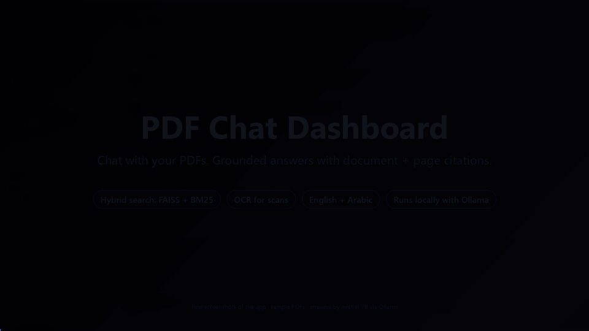

# PDF Chat Dashboard

> A simple, transparent RAG app. Upload PDFs (English, Arabic, scanned, tables), chat with them, and get grounded answers with document + page citations. Hybrid retrieval, streaming answers, local-only mode, and a vector store that survives restarts — without a heavy framework in sight.


[](docs/demo.mp4)

▶ **[Watch the 45-second demo in 1080p](docs/demo.mp4)** · real screenshots of the app running locally with Ollama (`mistral`) on sample PDFs

---

## Overview

PDF Chat Dashboard is a small Retrieval-Augmented Generation (RAG) app you can read end-to-end in an afternoon. PDFs are parsed with PyMuPDF (OCR fallback for scanned pages, tables kept as Markdown, multi-column reading order), split into structure-aware chunks that carry document / page / section / type metadata, embedded locally with the multilingual `BAAI/bge-m3` model, and indexed twice — `FAISS` for semantic similarity and `BM25` for keywords. At query time both rankings are fused with Reciprocal Rank Fusion (optionally reranked by a small cross-encoder), filtered by document and gated by an evidence floor. The answer is then streamed from your LLM of choice, which is told to answer only from the numbered sources and to cite them (or stays fully offline with Ollama or a no-API extractive fallback).

No LangChain. No LlamaIndex. Just three Python files.

---

## Features

- **Robust PDF extraction** (PyMuPDF) — multi-column reading order, tables → Markdown, running headers/footers removed, Arabic presentation forms normalized
- **OCR fallback** for scanned pages (Tesseract `eng+ara`, only on pages without a usable text layer)
- **Structure-aware chunks** — never span pages; headings become section metadata; tables split by rows with the header repeated
- **Multilingual embeddings** — `BAAI/bge-m3` (Arabic ⇄ English cross-lingual retrieval)
- **Hybrid retrieval** — dense (FAISS) + sparse (BM25, Arabic-normalized) fused with RRF, optional multilingual cross-encoder reranker
- **Grounded answers** — the LLM sees numbered sources only; when nothing clears the evidence floor the app replies *"I couldn't find this in the provided documents."* without calling the LLM
- **Citations** — every answer drawn from your documents ends with document + page sources; the source viewer shows page, section, type and relevance
- **Multi-PDF ingestion** with incremental indexing (only new chunks are embedded) and content-hash dedup
- **Per-document filtering** — restrict retrieval to a subset of loaded PDFs
- **Streaming responses** for Ollama, Groq, Hugging Face, and Together AI (live token-by-token)
- **Five LLM backends:**
  - **Ollama** (local, fully offline) — recommended for private documents
  - **Groq** (free, fast Llama 3 inference)
  - **HuggingFace** (Inference Providers router, Llama 3.1 8B)
  - **Together AI** (free, Mixtral-8x7B)
  - **Simple extractive fallback** (no key, no network)
- **Persistent vector store** — save/load indexes to disk; an index built with a different embedding model (or an older app version) is re-embedded automatically on load
- **Chat export** to Markdown or PDF
- **Zero hardcoded secrets** — keys live in the sidebar or your `.env`

---

## Architecture

```
                       ┌──────────────────────────┐
       PDF upload ────►│  PyMuPDF (+ OCR, tables) │
                       └────────────┬─────────────┘
                                    │
                                    ▼
                       ┌──────────────────────────┐
                       │  Structure-aware chunks  │
                       └────────────┬─────────────┘
                                    │
                       ┌────────────┴─────────────┐
                       ▼                          ▼
              ┌──────────────────┐      ┌──────────────────┐
              │  Embeddings      │      │  BM25 tokens     │
              │  (bge-m3)        │      │  (rank-bm25)     │
              └────────┬─────────┘      └────────┬─────────┘
                       ▼                         ▼
              ┌──────────────────┐      ┌──────────────────┐
              │ FAISS IndexFlatIP│      │  BM25 sparse idx │
              └────────┬─────────┘      └────────┬─────────┘
                       └───────┬─────────────────┘
                               ▼
                    ┌──────────────────────┐
                    │  RRF fusion (+rerank)│
                    │  + doc filter        │
                    │  + evidence floor    │
                    └──────────┬───────────┘
                               ▼
                    ┌──────────────────────┐
                    │  LLM provider        │
                    │  (streamed)          │
                    └──────────┬───────────┘
                               ▼
                          Grounded answer
                          + cited sources
```

**Project layout:**

```
ChatPDF/
├── app.py            # Streamlit UI + glue
├── rag.py            # PDF extraction/OCR, chunking, embeddings, FAISS, BM25, RRF, persistence
├── providers.py      # LLM calls with streaming (Ollama, Groq, HF, Together)
├── docs/             # demo.gif (README preview) + demo.mp4 (1080p)
├── requirements.txt
├── .env.example
├── .gitignore
├── LICENSE
└── README.md
```

---

## Tech Stack

| Layer | Technology |
|---|---|
| UI | Streamlit (with `st.write_stream`) |
| PDF parsing | PyMuPDF (+ Tesseract OCR, optional) |
| Embeddings | sentence-transformers (`BAAI/bge-m3`) |
| Reranker (optional) | `cross-encoder/mmarco-mMiniLMv2-L12-H384-v1` |
| Dense index | FAISS (CPU, inner-product) |
| Sparse index | rank-bm25 |
| LLMs | Ollama · Groq · HuggingFace · Together AI · local extractive |
| PDF export | fpdf2 |

---

## Installation

**Prerequisites:** Python 3.10+.

```bash
# 1. Clone
git clone https://github.com/<your-username>/pdf-chat-dashboard.git
cd pdf-chat-dashboard

# 2. Create a virtual environment
python -m venv .venv
# Windows
.venv\Scripts\activate
# macOS / Linux
source .venv/bin/activate

# 3. Install dependencies
pip install -r requirements.txt

# 4. (Optional) Configure providers
cp .env.example .env
# edit .env and add any keys you want to use
```

**Optional — local LLM via Ollama:**

```bash
# Install from https://ollama.com, then:
ollama serve            # runs the local model server
ollama pull llama3.2    # or: phi3, mistral, gemma2:2b
```

**Optional — OCR for scanned PDFs:** install [Tesseract](https://github.com/UB-Mannheim/tesseract/wiki) with the English and Arabic language data (`eng`, `ara`). The app finds it in the default install location or via `TESSDATA_PREFIX`. Without it, text PDFs work normally and scanned pages are reported as skipped.

> First run downloads `BAAI/bge-m3` (~2.3 GB) and caches it locally. Embedding runs on GPU if available, otherwise CPU (slower for large PDFs, but done once — save the index). For a much smaller, faster model set `EMBEDDING_MODEL=sentence-transformers/paraphrase-multilingual-MiniLM-L12-v2`. The optional reranker (~470 MB) downloads the first time you enable it.

---

## Usage

```bash
streamlit run app.py
```

Open the URL Streamlit prints (typically `http://localhost:8501`).

**Workflow:**
1. Pick an AI provider in the sidebar.
   - *Ollama* if you want it fully local.
   - *Groq / HF / Together* for cloud free tiers (paste key or set env var).
   - *Simple Extraction* needs nothing.
2. Upload one or more PDFs — the app chunks, embeds, and builds both indexes.
3. Hybrid search (dense + BM25 via RRF) is on by default; enable **Rerank** for extra precision. **Minimum Relevance** is the evidence floor — below it the app says it couldn't find the answer.
4. (Optional) Pick a subset of documents under **Limit to documents**.
5. Ask away (English or Arabic). Answers stream live with `[n]` citations, a **Sources** line (document + page), and an expandable source viewer.
6. **Save Index** to keep the work between sessions — reload it later from the sidebar.
7. **Export** the conversation as Markdown or PDF.

---

## Configuration

All settings are optional. Sidebar input wins; environment variable (or `.env`, when `python-dotenv` is installed) is the fallback.

| Env var | Purpose | Default |
|---|---|---|
| `GROQ_API_KEY` | Groq provider key | — |
| `HUGGINGFACE_API_KEY` | HuggingFace provider key | — |
| `TOGETHER_API_KEY` | Together AI provider key | — |
| `OLLAMA_BASE_URL` | Ollama server URL | `http://localhost:11434` |
| `OLLAMA_MODEL` | Default Ollama model (any installed model can be picked in the sidebar) | `llama3.2` |
| `OLLAMA_NUM_CTX` | Ollama context window (tokens) | `8192` |
| `GROQ_MODEL` / `TOGETHER_MODEL` / `HF_MODEL` | Cloud model overrides | see `.env.example` |
| `EMBEDDING_MODEL` | sentence-transformers model name | `BAAI/bge-m3` |
| `RERANKER_MODEL` | Cross-encoder used when *Rerank* is on | `cross-encoder/mmarco-mMiniLMv2-L12-H384-v1` |
| `CHUNK_SIZE` | Max words per chunk | `220` |
| `CHUNK_OVERLAP` | Words shared between adjacent chunks of the same section | `40` |
| `MAX_CONTEXT_CHARS` | Max characters of sources sent to the LLM | `14000` |
| `OCR_LANGUAGES` | Tesseract languages for scanned pages | `eng+ara` |
| `TESSDATA_PREFIX` | Tesseract `tessdata` folder (auto-detected if unset) | — |
| `REQUEST_TIMEOUT` | LLM HTTP timeout (seconds) | `60` |
| `DATA_DIR` | Where saved indexes live | `data` |

Get free API keys:
- Groq → <https://console.groq.com>
- HuggingFace → <https://huggingface.co/settings/tokens>
- Together AI → <https://api.together.xyz>

---

## Security Notes

- **No secrets in the repo.** `.env`, PDFs, saved indexes (`data/`), and model caches are git-ignored.
- **No persistence of uploads by default.** PDFs are parsed in memory and never written to disk. Use *Save Index* explicitly if you want to keep the embedded chunks on disk under `data/<name>/`.
- **No telemetry.** Embeddings stay local. API keys are only used to call the provider you selected.
- **Provider trust boundary.** When you call Groq / HuggingFace / Together, the retrieved chunks leave your machine — use **Ollama** or **Simple Extraction** for confidential documents.
- **Request timeouts** are enforced on every outbound LLM call.
- **Saved indexes** are plain files (`faiss.index` + `meta.json`) — protect the `data/` directory the same way you protect the original PDFs.

If you find a security issue, please open a private issue rather than a public PR.

---

## Future Improvements

- Remove a single document from a loaded index
- Borderless (whitespace-aligned) table detection
- SQLite-backed metadata store for multi-user deployments
- Cloud deployment recipe (Streamlit Community Cloud / Hugging Face Spaces)

---

## License

[MIT](LICENSE) — free to use, modify, and distribute.
